# 电路积木 · Circuit Lab

一个用 Python + pygame 写的电路小游戏：从左侧零件栏把元件拖到画布上，
用导线把端点连起来，就能看到电流、电压、功率和灯泡亮度的实时变化。
零件与导线的操作方式参考 Scratch：**从栏里拖出来 → 放到画布上 → 拖回去（或右键 / Delete）删除**。

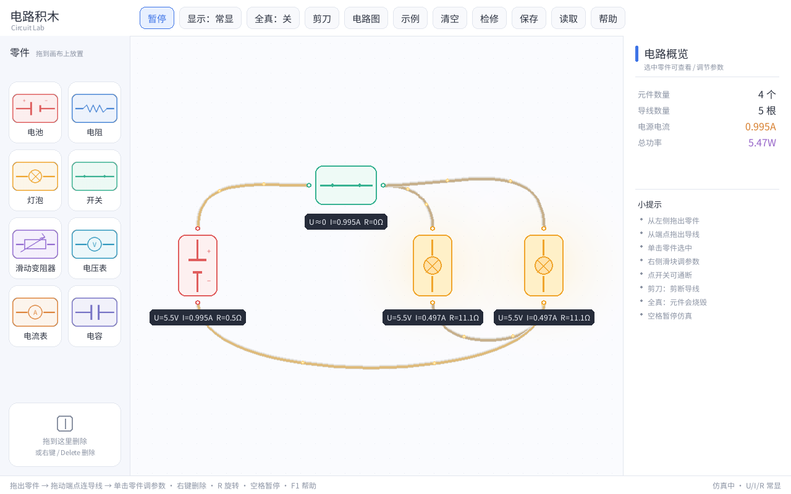

## 运行

整个 **电路积木** 文件夹就是完整的游戏包，拷到任何地方都能直接玩（源码、测试、
截图、示例导出文件都在里面，没有外部依赖目录）。

- 最简单：双击文件夹里的 **启动游戏.bat**（脚本会自己切到本目录、检查 Python 与 pygame，
  缺 pygame 时会自动 `pip install pygame-ce`）。
- 或者在命令行里：

```bat
cd 电路积木
python circuit_game.py
```

- Python 3.10 及以上（用到 `X | None` 类型写法）。
- 图形库：`pygame-ce`（也可用 `pygame`，代码 import 的都是 `pygame` 这个包名）。
- 无需联网、无其他依赖。界面中文字体优先用包内自带的 `fonts/NotoSansSC-Subset.ttf`
  （思源黑体子集，257KB，OFL 许可），找不到时才回退到系统的微软雅黑——所以拷到没有中文字体的机器或手机上也正常显示。
- 手机 / APK 见下面「手机触屏与打包 APK」一节；`main.py` 是给 buildozer 用的入口。

## 元件

| 元件 | 说明 | 可调参数 |
| --- | --- | --- |
| 电池 | 提供电动势，有内阻，端电压 `U = E − I·r` | 电动势 E、内阻 r |
| 电阻 | 普通电阻，额定功率 0.5W（全真模式会烧） | 阻值 R |
| 灯泡 | 会发光的电阻；**灯丝会发热**，冷态电阻只有热态的 1/9，亮度按灯丝温度 | 灯丝电阻 R（热态额定值） |
| 开关 | 单击闭合 / 断开 | 闭合状态 |
| 滑动变阻器 | 1–50Ω 可调，额定功率 1W，用来调亮度 | 阻值 R |
| 电压表 | 并联在元件两端测电压，内阻 1MΩ | — |
| 电流表 | 串联在回路里测电流，内阻 0.01Ω | — |
| 电容 | 储能元件，有充放电过程（τ = RC） | 容量 C、耐压 U_max |

## 怎么玩

| 操作 | 说明 |
| --- | --- |
| 从零件栏拖出 | 在左侧「零件」栏按住任意元件，拖到画布上松手 |
| 拖回零件栏删除 | 把画布上的零件拖回左侧零件栏（或拖到左下角「拖到这里删除」）松手即删除 |
| 右键删除 | 右键零件删除零件，右键导线删除导线 |
| Delete 删除 | 选中零件或导线后按 Delete |
| 连线 | 从零件两端的圆圈（端点）拖到另一个端点，松手就连上导线 |
| 移动零件 | 直接拖动零件，连着的导线会跟着走 |
| 调参数 | 单击零件选中，在右侧面板拖动滑块改电动势 / 内阻 / 阻值 / 容量 |
| 开关 | 单击开关即可闭合 / 断开，观察灯泡熄灭 |
| 剪刀 | 点工具栏「剪刀」（或按 X），再点导线**或元件本体**都能剪断成断路（模拟故障）；导线可在右栏「修复导线」，元件点「检修」或选中后「更换零件」恢复 |
| 电路图 | 点工具栏「电路图」进入电路图模式：自动排成标准电路图，可以继续画和改；点「生成电路」变回可仿真电路 |
| 导出 | 电路图模式里「导出 SVG」得到矢量电路图（浏览器能直接打开），「导出网表」得到纯文字节点表 |
| 全真模拟 | 点工具栏「全真：开」（或按 T）：过载的元件会发热、冒烟、烧毁甚至爆炸，过流的导线会烧断 |
| 暂停 | 空格 或工具栏「暂停」，暂停后画面冻结便于摆放 |
| 旋转 | 点右栏「旋转 90°（R）」按钮或按 R，把选中的零件每次转 90°（横放 / 竖放）；电池的 +/− 和仪表的 V/A 始终正立，不会跟着转倒 |
| 快速放置 | 1 电池、2 电阻、3 灯泡、4 开关、5 变阻器、6 电压表、7 电流表、8 电容 |
| 帮助 | F1 打开操作说明，Esc 关闭 |

### 全真模拟（会烧会炸）

打开「全真：开」后，每个元件都有额定功率（灯泡看额定电压、电阻 0.5W、变阻器 1W、
电流表 3A、电池 6A、电容看耐压），超过额定就会持续积热：

- 积热过程中元件边框会发红、冒烟；
- 热量满了以后：电阻 / 灯泡 / 变阻器 **烧毁**（炭黑、裂纹、余烬），电池 / 电容 / 电流表 **爆炸**（火花、烟雾、冲击波、闪光、震屏）；
- 导线电流超过 4A 会发红并最终 **烧断**（自动剪断，断口处有火花）；
- 损坏的元件在电路里等于断路，选中后右栏出现「更换零件」，或者用工具栏「检修」一键修好所有损坏。

| 电阻烧毁 | 电容过压爆炸 |
| --- | --- |
| 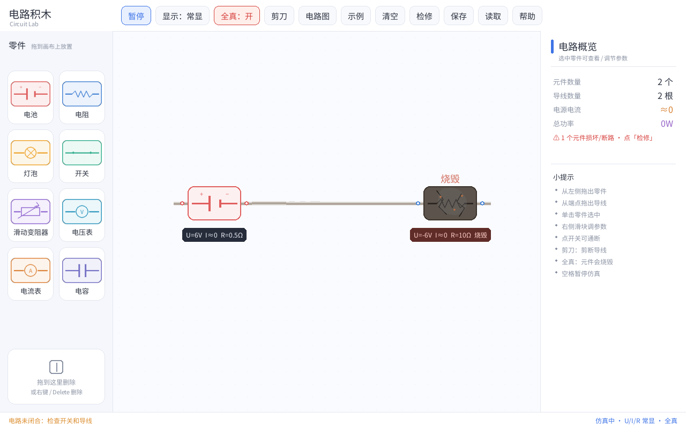 | 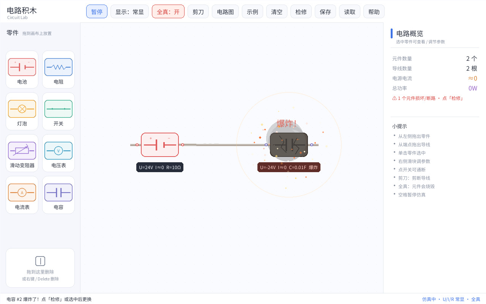 |

### 元件旋转

选中零件后按 R（或点右栏「旋转 90°（R）」按钮）每次转 90°，端点随之改变位置，
已经连好的导线会自动跟到新的端点上。电压表的 V、电流表的 A、电池的 +/− 是单独
正立绘制的，所以竖放时依然能读懂：

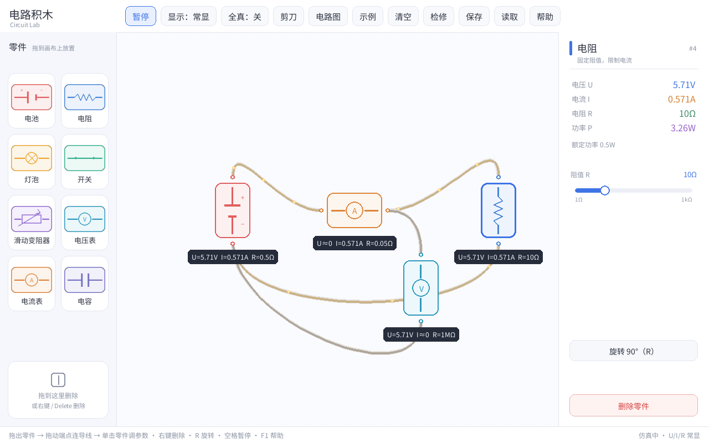

### 灯泡发热与热惯性

真实的钨丝灯泡不是「一通电就满亮」：冷态灯丝电阻只有热态的大约 **1/9**，所以刚通电瞬间电流会冲到
稳态的好几倍（冲击电流），灯丝迅速升温、电阻变大、电流回落，亮度才慢慢爬到稳定值。熄灯后热量又会慢慢散掉。

游戏里每一只灯泡都有独立温度（0 = 常温 300K，1 = 额定 2800K）：

| 状态 | 灯丝温度 | 灯丝电阻（12Ω 额定） | 现象 |
| --- | --- | --- | --- |
| 刚通电（冷态） | ≈300K | ≈1.32Ω | 电流约为稳态的 6 倍，灯丝暗红、几乎不发光 |
| 通电 0.5 秒 | ≈1500K | ≈6Ω | 明显发热，开始发出橙光 |
| 稳定（热态） | ≈2600–2800K | ≈11–12Ω | 电流回落到 0.5A、亮度 90% 左右，暖白光 |

右侧面板会显示「灯丝 2578K · 冷态 1.32Ω」和当前亮度；时间常数 `τ ≈ 0.45s`，所以开关灯泡时能看到
「先闪一下、再变亮」的过渡。

| 冷态（刚通电） | 热态（稳定发光） |
| --- | --- |
| 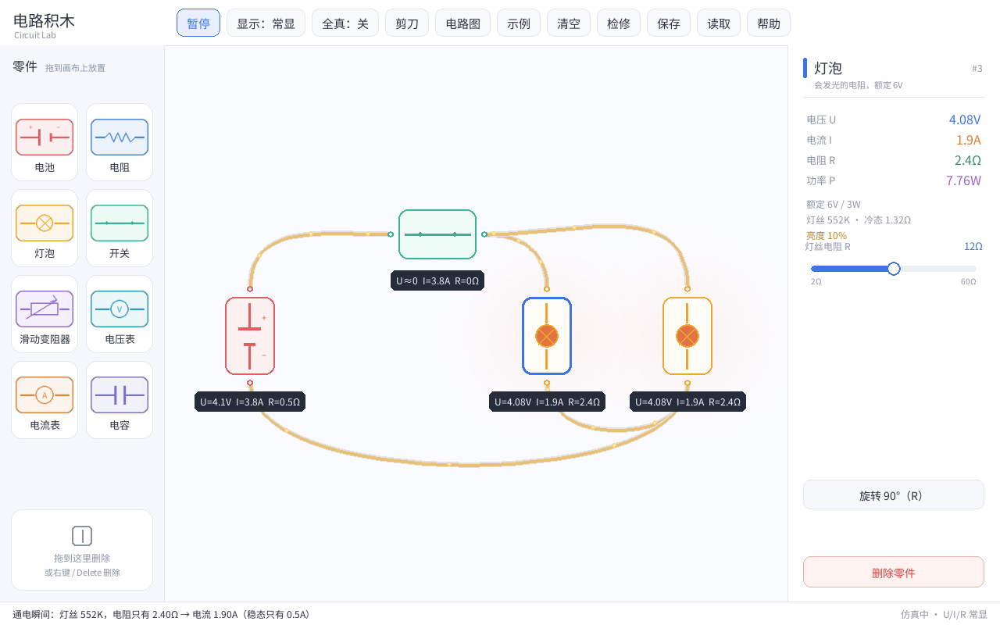 |  |

> 全真模式下，灯丝温度长期超过额定也会积热损坏——这也是真实灯泡「烧掉」的过程。

### 剪刀与断路故障

「剪刀」模式下鼠标移到导线上会高亮，单击即剪断：导线留在画布上但电路断开，
断口处会显示一截缺口，底部状态栏提示「电路断路了」。导线面板里可以「修复导线」，
工具栏「检修」可以一次修好所有故障。

剪刀也可以直接剪**元件本体**：点一下灯泡 / 电阻 / 电池，元件中间会出现红色虚线断口，
这个元件在电路里就变成断路（状态栏与徽标都会标「断路」），但它没有被烧毁，
点「检修」或选中后「更换零件」就能恢复。

| 剪断导线前（悬停高亮） | 剪断导线后 | 剪断元件 |
| --- | --- | --- |
| 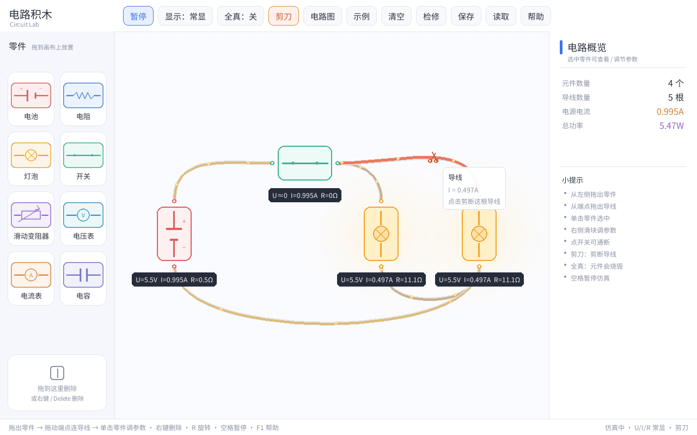 | 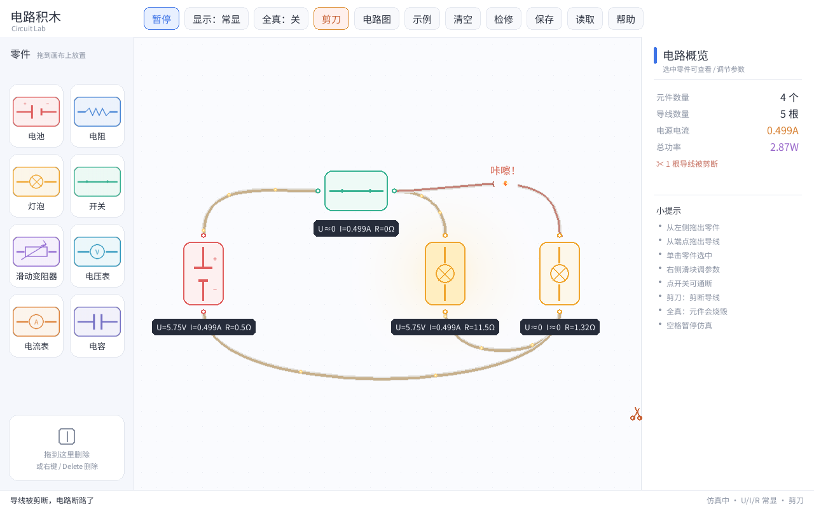 | 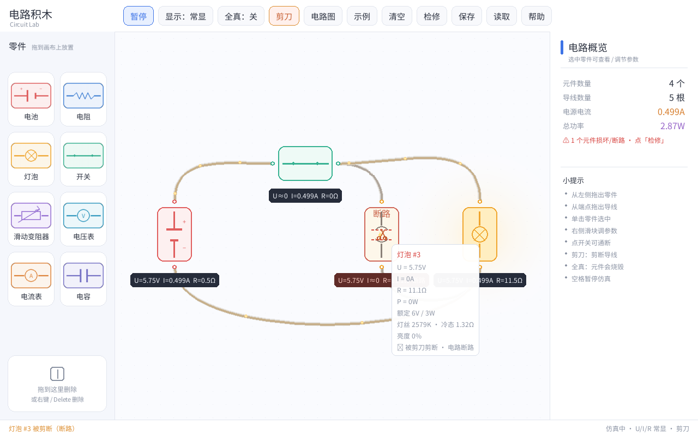 |

### U / I / R 的三种显示方式

工具栏的「显示：」按钮循环切换：

1. **常显**（默认）—— 每个零件下方直接显示 `U=…  I=…  R=…`（导通时还有功率与亮度提示）。
2. **悬浮显示** —— 画布上不挂徽标，鼠标移到零件上时在零件旁弹出详细信息（电压、电流、电阻、功率、额定值、亮度）。
3. **单击显示** —— 只有选中的零件才显示参数徽标。

| 悬浮显示 | 单击显示 |
| --- | --- |
| 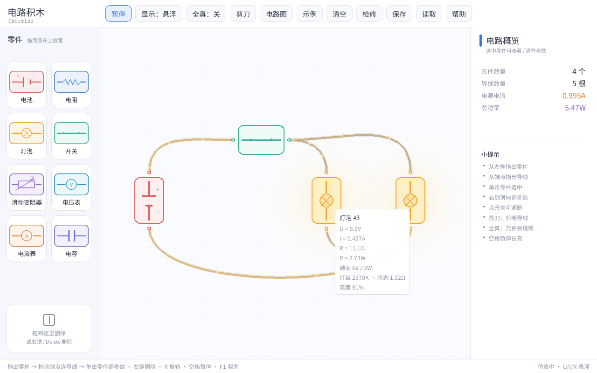 | 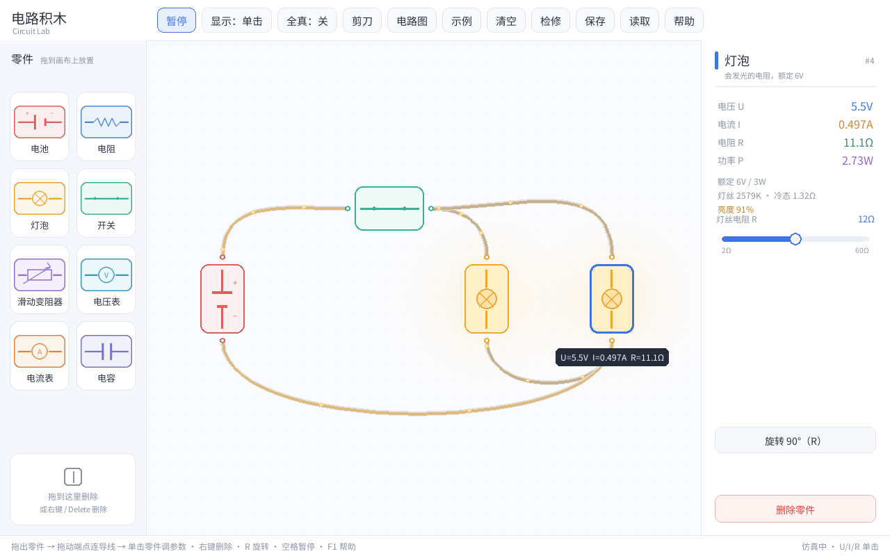 |

数值会自动用合适的单位（V / mV、A / mA、Ω / kΩ、W），并做噪声抑制：
接近 0 的电压、电流显示为 `≈0`，不会出现 `923µV` 这样的读数。

### 电路图模式（组电路 ↔ 电路图）

工具栏「电路图」按钮会把你已经组好的电路**自动排成一张标准电路图**：元件用国际通用符号
（电池极板、电阻折线、灯泡圆圈、开关拨杆、电表圆圈……）画，导线走横平竖直的正交路径，
不依赖任何图片素材——全部是程序按几何图形实时画出来的，所以放大也清晰。

进入电路图模式后：

- 画布变成方格纸，零件可以继续从左边拖出来、连线、旋转、调参数（对齐 24px 网格）；
- 「自动整理」按拓扑重新排一遍；
- 「导出 SVG」写出一份**矢量**电路图 `circuit_diagram.svg`（纯文本 SVG，浏览器 / Illustrator 都能打开，不是截图）；
- 「导出网表」写出 `circuit_netlist.txt`：节点表（N1 = 电池#1.0, 开关#2.0 …）、元件接在哪两个节点之间、每根导线属于哪个节点、是否被剪断；
- 「生成电路」把电路图里的连线和布局带回画板，变回可以仿真、可以烧元件的那套电路；
- 「返回画板」放弃改动，回到原来的布局。

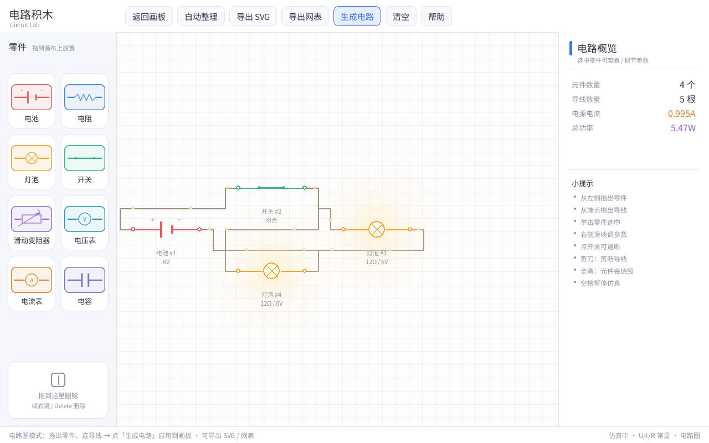

| 导出（SVG / 网表） | 生成电路后回到画板 |
| --- | --- |
| 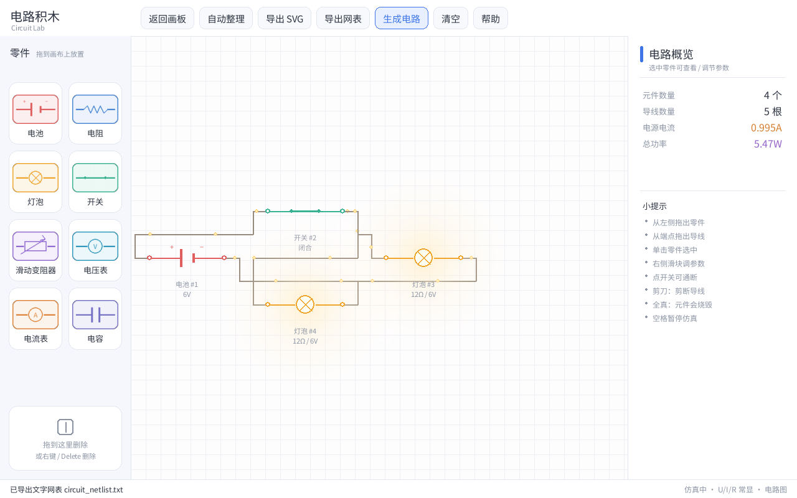 | 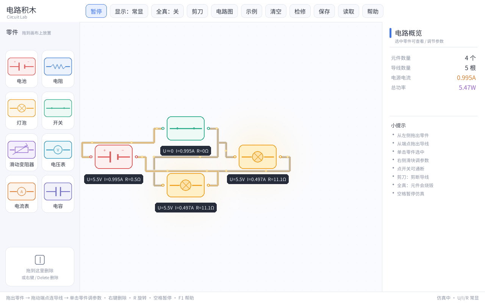 |

导出的 SVG 长这样（节选，纯文本、可编辑）：

```svg
<?xml version="1.0" encoding="UTF-8"?>
<svg xmlns="http://www.w3.org/2000/svg" width="798" height="712" viewBox="0 0 798 712">
  <polyline points="30,356 6,356 101,356 101,281 196,281 220,281" fill="none" stroke="#9a8c80"/>
  <line x1="86" y1="342" x2="86" y2="370" stroke="#d05e5e" stroke-width="4"/>
  ...
</svg>
```

## 示例电路

工具栏「示例」在三个例子之间循环：

1. **并联灯泡**：电池 + 开关 + 两只并联灯泡（6V / 0.5Ω + 12Ω×2，I≈0.923A，每灯 0.461A、2.55W、亮度 85%）；
2. **电压表 + 电流表**：电流表串联读 0.571A，电压表并联在 10Ω 电阻上读 5.71V；
3. **电容 RC 充电**：100Ω + 10mF，时间常数 τ = 1s，可以看着电容电压一点点爬向电源电压。

| 仪表 | RC 充电 |
| --- | --- |
| 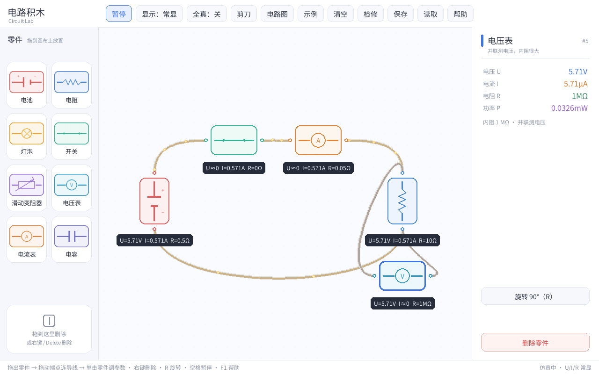 | 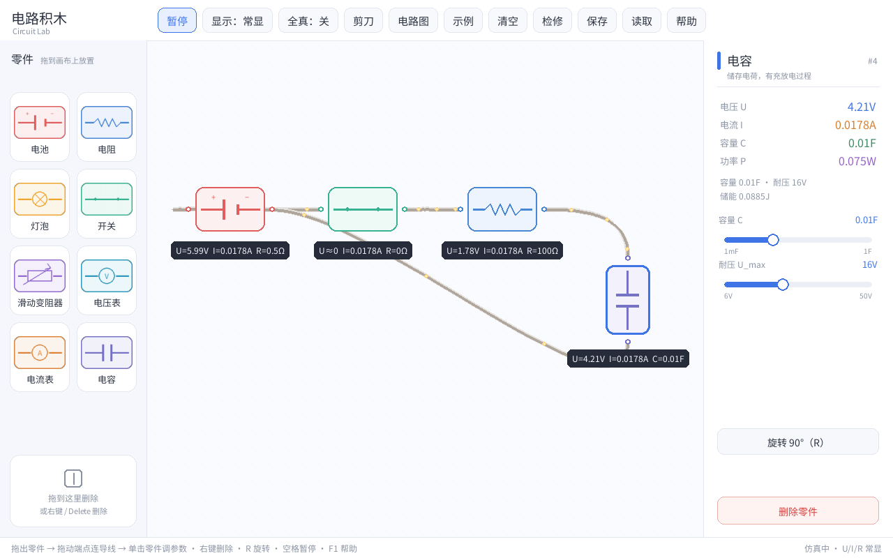 |

## 电路模型

`circuit_core.py` 是不依赖图形库的纯 Python 电路求解器：

- **节点电压法（MNA）**：把每个电气连通块选一个接地点，列导纳矩阵求解；
- 电池用**诺顿等效**（`g = 1/r_internal`、`E = 电动势`）表示，避免理想电压源导致的奇异矩阵；
- 导线 `1mΩ`、闭合开关 `1mΩ`，所以串联电路的总电流会比理想值略小一点（这也更真实）；
- 电池端电压 `U = E − I·r`，灯泡按 `P = U·I` 计算亮度（相对额定功率），过载会给出警告；
- **电容**用后向欧拉伴随模型（`g = C/dt`，串联电压源 `v_prev`）逐帧做瞬态求解，所以能看到 RC 充放电曲线；
  电路里没有电容时按直流稳态一次解出；
- **仪表**：电压表 1MΩ（几乎不分流）、电流表 0.01Ω（几乎不分压），读数就是它们的端电压 / 通过电流；
- **故障**：剪断的导线、烧毁 / 爆炸的元件都不参与求解，等价于断路；
- 短路、电路未闭合、没有电源、元件过载 / 损坏、导线被剪断等情况都会显示在底部状态栏和右侧概览。

数值经过单元测试校验：串联 `I = E / (r + R1 + R2 + 3×1mΩ)`、并联分流、
断开开关时电流为 0 且开关两端承担全部电动势、功率平衡（电源输出 = 零件消耗 + 导线损耗）、
RC 充电符合 `U = E·(1 − e^(−t/τ))`。

## 文件结构

```
电路积木/                 ← 整个文件夹就是发布包，可整体拷走
├─ 启动游戏.bat           双击启动（自动检查 Python / pygame）
├─ circuit_game.py        pygame 界面：零件栏、画布、右侧参数面板、动画与特效、电路图模式
├─ circuit_core.py        电路模型与求解器（无图形依赖，可单独 import）
├─ schematic.py           电路图模块：标准符号、正交走线、自动排版、SVG 与网表导出（纯 Python）
├─ main.py                手机 APK 的入口（buildozer / python-for-android 从这里启动）
├─ buildozer.spec         buildozer 打包配置（标题、包名、横屏、全屏、架构、依赖）
├─ android/README_APK.md  打包 APK 的详细步骤（CI / WSL2 / Docker 三种方式）
├─ .github/workflows/build-apk.yml  GitHub Actions 自动出 APK 的工作流
├─ fonts/                 内置中文字体（思源黑体子集 257KB + OFL 许可证）
├─ make_screenshots.py    无头渲染 screenshots/ 里的 23 张截图（SDL_VIDEODRIVER=dummy）
├─ make_font_subset.py    重新生成字体子集（改了界面文字后跑一次，避免缺字）
├─ test_circuit_core.py   电路求解器单元测试（65 项，含灯泡热惯性）
├─ test_schematic.py      电路图模块测试（20 项：走线、排版、SVG、网表）
├─ test_interaction.py    界面交互测试（110 项，无头运行，含触控/缩放与整帧循环冒烟）
├─ README.md              本说明
├─ screenshots/           23 张运行截图（01–23）
├─ circuit_diagram.svg    「导出 SVG」写出的矢量电路图（示例）
├─ circuit_netlist.txt    「导出网表」写出的文字网表（示例）
└─ circuit_save.json      「保存」按钮写出的存档（首次保存后出现，读取同一个文件）
```

## 手机触屏与打包 APK

游戏本体已经适配手机，逻辑画布固定 1280×800，窗口任意大小都会**等比缩放 + 居中留边**：

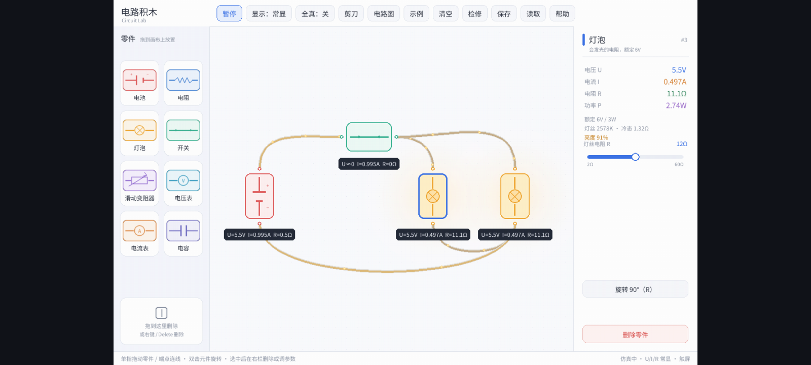

### 触控操作

| 操作 | 手机上的做法 |
| --- | --- |
| 放零件 | 从左侧零件栏**按住拖**到画布（触屏命中区域自动放大 1.7 倍，手指也能点准） |
| 连线 | 按住零件端点圆圈，拖到另一个端点松手 |
| 移动 | 单指拖动画布上的零件，导线跟着走 |
| 旋转 | **双击**同一零件 = 转 90°（也可选中后点右栏「旋转 90°」） |
| 调参数 / 删除 | 点选零件，在右侧面板拖滑块 / 点「删除零件」 |
| 剪刀 | 点工具栏「剪刀」，再点导线或元件 |

Android 上检测到 `ANDROID_ARGUMENT` 或 `sys.platform == "android"` 会自动全屏启动，隐藏鼠标指针，
底部状态栏提示也会切换成触屏说明。桌面窗口可以用 F11 全屏 / 退出全屏。

### 打包成 APK

本仓库已带好 buildozer 配置和 CI 工作流，**但没有现成 .apk**：当前这台 Windows 机器只有 JDK 1.8、
没有 Android SDK，也没装 Linux 发行版，打包必须在 Linux 上做。三种方式（详见 `android/README_APK.md`）：

1. **GitHub Actions（推荐）**：把文件夹推到 GitHub，Actions 里运行 `Build Android APK`，完成后下载 artifact；
2. **WSL2 Ubuntu**：`buildozer -v android debug`；
3. **Docker**：`docker run --rm -v "$PWD":/home/user/hostcwd kivy/buildozer -v android debug`。

产物在 `bin/` 下，`adb install` 或直接传到手机安装即可。首次构建会下载 Android SDK/NDK，约 10–30 分钟。

## 存档

工具栏「保存」把电路（零件、参数、开关状态、导线、剪断的导线、元件损坏状态）和零件的布局位置
写入 `circuit_save.json`，「读取」恢复上次的电路。文件是可读的 JSON，方便手工改或分享。

## 测试

在 **电路积木** 文件夹里运行：

```bat
cd 电路积木
python -m unittest test_circuit_core test_schematic test_interaction -v
```

也可以分开跑（求解器 65 项 / 电路图 20 项 / 交互 110 项，共 195 项），全部用标准库 unittest，无需 pytest。

交互测试用 pygame 的 dummy 视频驱动模拟鼠标拖拽、端点连线、剪刀剪断（导线和元件）、滑块调参、
烧毁 / 爆炸、电路图模式切换、生成电路、SVG / 网表导出、存档往返，触屏事件（FINGERDOWN/MOTION/UP）、
窗口等比缩放与坐标换算、双击旋转、冷态灯丝升温，还有整帧循环（更新 + 绘制）连续跑几百帧的冒烟测试，
即使没有显示器（或远程 SSH）也能跑。

## 小目标

- 让两只灯泡一样亮（示例电路默认就是）；
- 用滑动变阻器把灯泡调到刚好看不出发光，再调亮回来；
- 把开关换成导线，看看短路提示；打开「全真」再看看电池爆炸；
- 把两只灯泡改成串联，比较亮度变化；
- 给电容配不同的 R，观察充电快慢（τ = RC）；
- 用电压表同时测灯泡两端，比较灯泡电压 + 变阻器电压是否等于电源电压；
- 组一个电路后点「电路图」，导出 SVG 看看标准电路图长什么样，再用「生成电路」带回来；
- 用剪刀剪断一个元件假装它坏了，观察电路哪里不亮了，再点「检修」修好；
- 关掉再打开开关，盯着灯泡看「先闪一下再变亮」——那是冷态灯丝的小电阻在吃电流；
- 把灯泡换成 2Ω 再试一次，比较冷态冲击电流和稳定亮度的差别。
